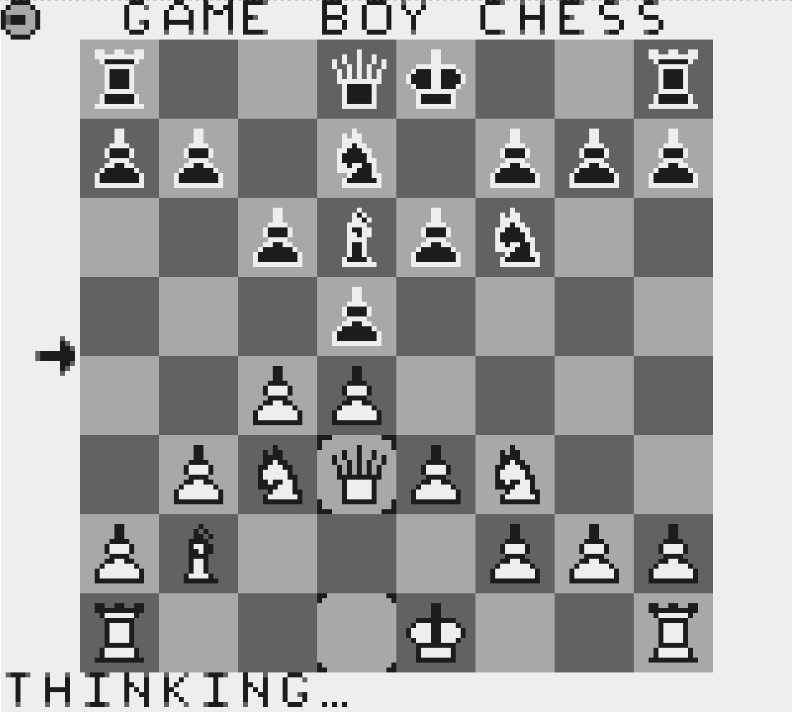

# Game Boy Chess

A complete chess game for the original Nintendo Game Boy DMG, written in C with
[GBDK-2020](https://github.com/gbdk-2020/gbdk-2020). The whole thing (engine,
opening book, graphics and UI) fits in a 32 KB ROM and runs on the Game Boy's
8-bit CPU with its tiny amount of RAM.

It was written for my [IOCCC 29 entry](https://github.com/ncw/ioccc-gameboy)
GameBoy emulator to be one of the ROMS that I distrubted with it.

Download the ROM [gbchess.gb](./gbchess.gb) from the repo.



## Features

- A real chess engine running on real (or emulated) Game Boy hardware:
  - [0x88 board representation](https://en.wikipedia.org/wiki/0x88) with full move generation and validation
  - [Negamax search](https://en.wikipedia.org/wiki/Negamax) with [alpha-beta pruning](https://en.wikipedia.org/wiki/Alpha%E2%80%93beta_pruning) and [iterative deepening](https://en.wikipedia.org/wiki/Iterative_deepening_depth-first_search)
  - [Quiescence search](https://www.chessprogramming.org/Quiescence_Search) to avoid the horizon effect
  - [MVV-LVA move ordering](https://www.chessprogramming.org/MVV-LVA) (Most Valuable Victim − Least Valuable Aggressor)
  - Incrementally-updated evaluation: material + [piece-square tables](https://www.chessprogramming.org/Piece-Square_Tables)
  - A dedicated endgame evaluator (king-to-edge mop-up, king activation) so
    it can actually finish off K+P vs K and similar endings
  - Repetition detection with a "smart contempt" factor (takes a draw when
    losing, avoids one when winning)
  - All search state lives on a global stack rather than the C call stack, to
    stay within the Game Boy's limited RAM
- Opening book compiled into the ROM so the first moves play instantly
- Full rules: castling, en passant, pawn promotion, check, checkmate and
  stalemate detection
- Four difficulty levels (~900 to ~1325 Elo) and four player configurations
  (Human v Human, Human v Computer, Computer v Human, Computer v Computer)
- Polished UI: animated piece movement with ghost pieces, a live evaluation
  bar, last-move highlighting, a "thinking" spinner, board flipping (automatic
  for the human side), in-game menus, undo, sound effects and a help screen
- You can interrupt the engine mid-think (**hold B**) to make it play now,
  continue, flip the board or start a new game

## Strength

The engine has been tested over thousands of games against Stockfish (with
`UCI_LimitStrength`). Approximate ratings by search depth:

| Difficulty | Depth | Elo (vs Stockfish) |
|------------|-------|--------------------|
| Beginner   | ~1    | ~900               |
| Easy       | ~1-2  | ~1050              |
| Medium     | 2     | ~1250              |
| Hard       | 3     | ~1325              |

(Levels above the base depth automatically search deeper in the endgame.)

## Controls

| Button   | Action            |
|----------|-------------------|
| D-Pad    | Move cursor       |
| A        | Pick up / place piece |
| B        | Cancel selection  |
| Hold B   | Stop the CPU thinking (opens the interrupt menu) |
| SELECT   | Open the in-game menu |

The goal, naturally, is to checkmate the opponent's king.

## Building

The project is designed to compile **both** for the Game Boy and for the host
machine - running the exact same engine code on the host is what makes it
practical to test and debug. This is driven by the `Makefile`.

### Prerequisites

- [GBDK-2020](https://github.com/gbdk-2020/gbdk-2020) installed at `/opt/gbdk`
  (override with `GBDK_ROOT` in the `Makefile`)
- `gcc` for the host builds
- Optionally [Stockfish](https://stockfishchess.org/) and `python-chess` for
  running strength tests (`match.py`)

### Build everything

```sh
make           # builds host binaries and Game Boy ROMs
make gb        # just the Game Boy ROMs
make host      # just the host binaries
```

The playable ROM is produced at `bin/gbchess.gb`. Load it into a Game Boy
emulator (or a flash cart) to play.

## Project layout

### Shared engine (compiles for GB and host)

| File          | Purpose |
|---------------|---------|
| `chess.c/.h`  | 0x88 board, move generation, make/unmake, rules |
| `eval.c/.h`   | Material, piece-square tables, endgame evaluation, position hashing |
| `engine.c/.h` | Negamax + alpha-beta + quiescence search, iterative deepening, move ordering |
| `book.c/.h`   | Opening-book lookup |
| `book_data.c` | Generated opening-book data (from `book.txt`) |

### Game Boy front-end

| File          | Purpose |
|---------------|---------|
| `gbchess.c`   | The Game Boy game: rendering, sprites, input, menus, animation |
| `tiles.c/.h`  | Tile graphics, generated from `tiles.png` by `png2asset` |
| `sound.c/.h`  | Sound effects |

### Host tools & test harnesses

| File             | Purpose |
|------------------|---------|
| `uci.c`          | UCI front-end so the engine can play other engines / GUIs |
| `perft.c`        | Move-generator correctness testing (perft) |
| `random_game.c`  | Plays random games to sanity-check move generation |
| `one_ply.c`      | Plays the best 1-ply move (early engine prototype) |
| `full_player.c`  | Full-search self-play driver |
| `book_gen.c`     | Compiles `book.txt` into `book_data.c` |
| `match.py`       | Runs matches vs Stockfish and reports Elo with 95% confidence intervals |

## How it works

The engine uses a classic 0x88 board where off-board squares are detected with a
single `sq & 0x88` test which is cheap on an 8-bit CPU. Moves are generated as
pseudo-legal and checked for legality lazily inside the search by making the
move and testing whether the king is left in check.

The evaluation is kept in a global score that is updated incrementally as pieces
are added, removed and moved, so it costs almost nothing to read during search.
It combines raw material value with piece-square tables that nudge pieces toward
good squares. Once material thins out (or one side has a large lead) a separate
endgame function takes over, driving the losing king to the edge and bringing
the winning king in to help deliver mate.

Search is negamax with alpha-beta pruning, wrapped in iterative deepening (so a
search interrupted mid-way still has a good move from the previous depth) and a
quiescence search at the leaves that only follows captures and promotions to
avoid incorrect evaluations in the middle of a trade.

## License

Released under the [MIT License](LICENSE).
