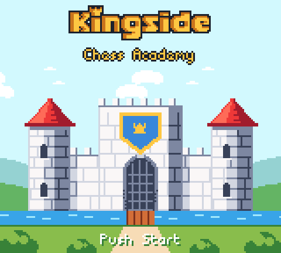
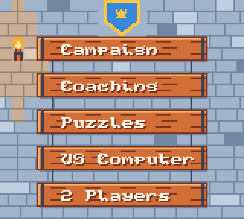
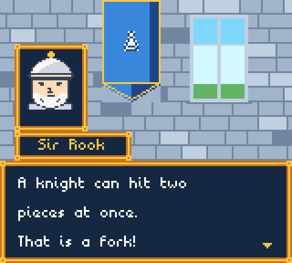
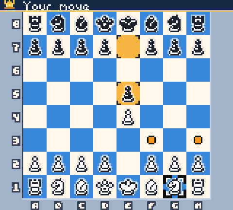

# Kingside: Chess Academy

A chess game for the Game Boy Color, set in a castle, that teaches as you
play. This folder holds its art and the chess code it will run. The game
itself is not playable yet; the upstream gbchess game in the repo root is a
separate program.

| Title | Main menu | Lesson | Board |
| --- | --- | --- | --- |
|  |  |  |  |

The pictures are frames captured from the preview ROMs in an emulator. On
the title, the two rows of clouds drift at different speeds behind the
castle.

## What is here

- `tools/castle_art.py` draws the four screens at 160x144 and cuts each into
  Game Boy Color tiles, failing with the cell's position when an 8x8 cell
  needs more than four colours or no palette fits it.
- `tools/mockup_rom/` holds the preview ROMs: one loader that shows a screen,
  and one for the title that scrolls the cloud rows with a scanline interrupt.
- `engine/` is the chess code the game will use: legal moves, game history
  with repetition and draw claims, and a search that runs in small steps so
  the screen and buttons stay responsive while the computer thinks.
- `assets/` holds the piece art and fonts the tool draws from.

## Building the previews

Needs GBDK-2020 and Python 3 with Pillow (`pip install pillow`).

```bash
cd tools/mockup_rom
make GBDK_HOME=/opt/gbdk/
```

The ROMs land in `build/mockup/`. They need a Game Boy Color.

## Credits

- Chess pieces, board labels and squares: [Super Game Boy Chess asset
  pack](https://roupiks.itch.io/) by roupiks. See `assets/chess/LICENSE.txt`.
- Fonts: Not Jam Third Dimension, Not Jam Mono Old Peculiar and Undead Pixel
  by Not Jam, released under CC0. See `assets/fonts/LICENSE.txt`.
- The screens are drawn by code written with Claude Code, an AI assistant,
  and the chess code in `engine/` was written the same way.
